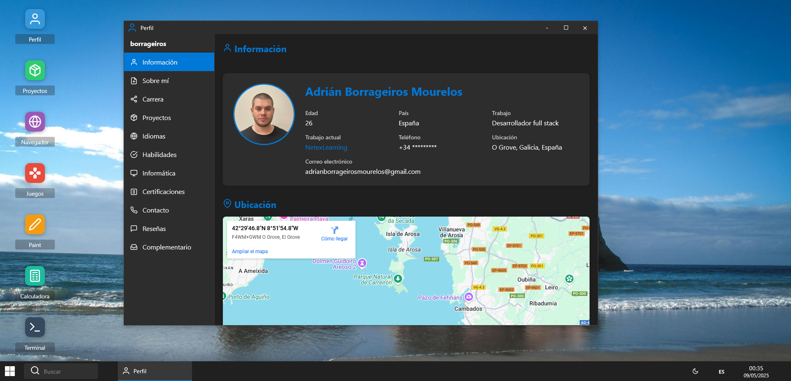

# 🖥️ PortfoliOS - Borrageiros Creative Portfolio



## 🌟 What is PortfoliOS?

PortfoliOS is a creative web portfolio inspired by operating system design. It offers a unique and interactive experience to showcase skills, projects, and professional experience by simulating a desktop interface with windows, applications, and menus.

🔗 **Live website:** [borrageiros.com](https://borrageiros.com)

### ✨ Main features:

- 🎨 Original design inspired by operating systems
- 🌓 Light/dark mode
- 🌐 Multilingual (Spanish and English)
- 📱 Mobile-friendly version
- 🖼️ Interactive and customizable windows
- 📂 Intuitive file explorer-like navigation

## 🛠️ Installation

```bash
npm install
```

## 🚀 Development

The contact forms are handled by the Cloudflare Worker in `worker/`. Run both processes:

```bash
# Terminal 1: API
npm run worker:dev

# Terminal 2: site
npm run dev
```

The Vite dev server proxies `/api` to `http://127.0.0.1:8787`.

## 📦 Building

Create a production version:

```bash
npm run build
```

The static output is written to `build/`. You can preview it with `npm run preview`.

## 🤝 Contributions

Contributions are welcome. Feel free to fork, improve, or expand this project.
